<!--
  ╔══════════════════════════════════════════════════════════════════╗
  ║   THE WORLD MACHINE — GITHUB PROFILE                            ║
  ║   Pablo Trujillo Artunduaga                                     ║
  ║   Sprites/faces © their respective creators (fan work).         ║
  ║   Assets: pdn6606/TWM-xfce (MIT). OneShot © Future Cat LLC.    ║
  ╚══════════════════════════════════════════════════════════════════╝
-->

<div align="center">

<!-- ════════════════════════════════════════════════
     [ BOOT SEQUENCE — The World Machine Terminal ]
     ════════════════════════════════════════════════ -->


<br/>


&nbsp;

&nbsp;


</div>

---

<!-- ════════════════════════════════════════════════
     DESKTOP NAVIGATION — Icon Dock
     ════════════════════════════════════════════════ -->

<div align="center">

<a href="#-about_metxt"></a>&nbsp;&nbsp;
<a href="#-my_computer">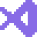</a>&nbsp;&nbsp;
<a href="#-projects"></a>&nbsp;&nbsp;
<a href="#-system_monitor"></a>&nbsp;&nbsp;
<a href="#-notes"></a>&nbsp;&nbsp;
<a href="#-power_status"></a>&nbsp;&nbsp;
<a href="#-contacts">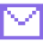</a>

<br/>

```
[ ABOUT_ME.txt ]  [ MY_COMPUTER ]  [ PROJECTS ]  [ SYSTEM_MONITOR ]  [ NOTES.txt ]  [ POWER_STATUS ]  [ CONTACTS ]
```

</div>

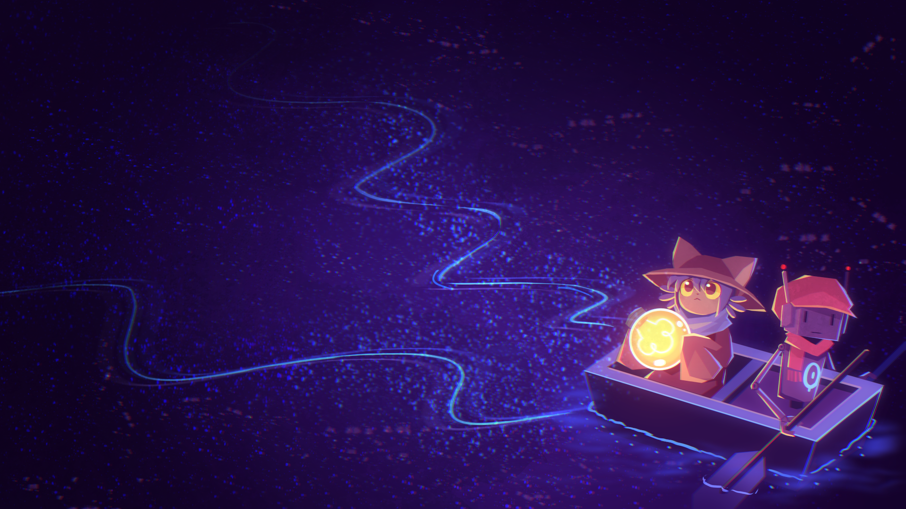

---

<!-- ════════════════════════════════════════════════
     ABOUT_ME.txt
     ════════════════════════════════════════════════ -->

##  &nbsp;ABOUT_ME.txt

<table>
<tr>
<td width="160" align="center" valign="top">

<br/>
<sub><code>sys.entity</code></sub>

</td>
<td valign="top">

```
THE_WORLD_MACHINE > cat ABOUT_ME.txt
─────────────────────────────────────────────────────
  NAME   : Pablo Trujillo Artunduaga
  ROLE   : Software Engineering Student
  SCHOOL : Universidad Surcolombiana, Colombia
  FOCUS  : Backend · OOP · Clean Code · Architecture
─────────────────────────────────────────────────────
```

**I have found you, the one at the console.**

I am a Software Engineering student at Universidad Surcolombiana (Colombia),
focused on becoming a solid, highly competent developer.
Every world needs an engineer. Mine is built line by line.

- `◆` Studying Software Engineering at Universidad Surcolombiana
- `◆` Currently deepening backend development and OOP foundations
- `◆` Learning by building — every project is a chance to write cleaner code
- `◆` Open to collaborating, learning from others, and taking on new challenges

> *"The sun is a lightbulb. As long as you keep building, the light stays on."*

</td>
</tr>
</table>

---

<!-- ════════════════════════════════════════════════
     MY_COMPUTER — Tech Stack
     ════════════════════════════════════════════════ -->

##  &nbsp;MY_COMPUTER

<table>
<tr>
<td width="160" align="center" valign="top">

<br/>
<sub><code>modules.sys</code></sub>

</td>
<td valign="top">

```
THE_WORLD_MACHINE > system --list-modules
─────────────────────────────────────────────────────
  MODULE          FUNCTION
  ─────────────────────────────────────────────────
  Python · Java   OOP, backend logic, desktop apps
  JS · React      Frontend, dynamic web apps
  HTML · CSS      Structure, styling, layouts
  PostgreSQL      Relational database design
  MySQL           Data modeling and management
  Git · GitHub    Version control, collaboration
  VS Code         Primary development environment
─────────────────────────────────────────────────────
  FOCUS_AREAS:
  > Clean Code  > OOP  > Backend Dev  > Architecture
─────────────────────────────────────────────────────
```

</td>
</tr>
</table>

<div align="center">
  <a href="https://skillicons.dev/">
    
  </a>
</div>

<br/>

<table align="center">
<tr>
  <th>◆ Module</th>
  <th>◆ Current Level</th>
  <th>◆ Function</th>
</tr>
<tr>
  <td><b>Python · Java</b></td>
  <td><code>▓▓▓▓▓▓▓░░░</code> Learning</td>
  <td>OOP, backend logic, CLI tools</td>
</tr>
<tr>
  <td><b>JavaScript · React</b></td>
  <td><code>▓▓▓▓▓░░░░░</code> Learning</td>
  <td>Frontend interfaces, dynamic apps</td>
</tr>
<tr>
  <td><b>PostgreSQL · MySQL</b></td>
  <td><code>▓▓▓▓▓▓░░░░</code> Learning</td>
  <td>Database design, data modeling</td>
</tr>
<tr>
  <td><b>HTML · CSS</b></td>
  <td><code>▓▓▓▓▓▓▓░░░</code> Comfortable</td>
  <td>Web structure, styling, layouts</td>
</tr>
<tr>
  <td><b>Git · GitHub · VS Code</b></td>
  <td><code>▓▓▓▓▓▓▓▓░░</code> Daily use</td>
  <td>Version control, optimized workflow</td>
</tr>
</table>

---

<!-- ════════════════════════════════════════════════
     PROJECTS — File Explorer
     ════════════════════════════════════════════════ -->

##  &nbsp;PROJECTS

<table>
<tr>
<td width="160" align="center" valign="top">

<br/>
<sub><code>project.log</code></sub>

</td>
<td valign="top">

```
THE_WORLD_MACHINE > ls -la ./projects/
─────────────────────────────────────────────────────
  Every file in this directory was built by hand.
  Every bug was a lesson.
  Every commit is a checkpoint.
─────────────────────────────────────────────────────
```

</td>
</tr>
</table>

<br/>

<div align="center">

<table>
<tr>
  <th><br/>sistema-comercial-nancy</th>
  <th><br/>cacaoBot</th>
  <th><br/>MorazulFragancias</th>
</tr>
<tr>
  <td align="center">Commercial management<br/>system for a small business</td>
  <td align="center">Agricultural data assistant<br/>with automated processing</td>
  <td align="center">Web platform for a<br/>local fragrance store</td>
</tr>
<tr>
  <td align="center"><code>Java</code> <code>MySQL</code></td>
  <td align="center"><code>Python</code> <code>APIs</code></td>
  <td align="center"><code>JavaScript</code> <code>HTML</code> <code>CSS</code></td>
</tr>
<tr>
  <td align="center">
    <a href="https://github.com/PabloTrujilloArtunduaga/sistema-comercial-nancy">
      
    </a>
  </td>
  <td align="center">
    <a href="https://github.com/PabloTrujilloArtunduaga/cacaoBot">
      
    </a>
  </td>
  <td align="center">
    <a href="https://github.com/PabloTrujilloArtunduaga/MorazulFragancias">
      
    </a>
  </td>
</tr>
</table>

</div>

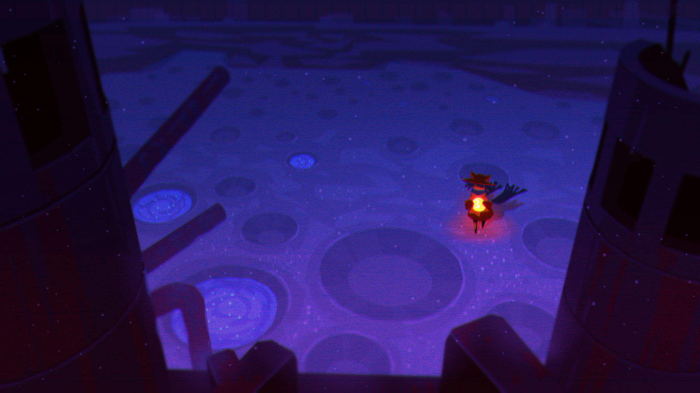

---

<!-- ════════════════════════════════════════════════
     SYSTEM_MONITOR — GitHub Stats
     ════════════════════════════════════════════════ -->

##  &nbsp;SYSTEM_MONITOR

<table>
<tr>
<td width="160" align="center" valign="top">

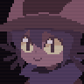<br/>
<sub><code>diagnostics</code></sub>

</td>
<td valign="top">

```
THE_WORLD_MACHINE > system --diagnostics github
─────────────────────────────────────────────────────
  > Scanning repository activity...
  > Compiling language statistics...
  > Cross-referencing commit history...
  > MACHINE STATUS: ALL SYSTEMS RUNNING ■
─────────────────────────────────────────────────────
```

</td>
</tr>
</table>

<br/>

<div align="center">


<br/>


</div>

---

<!-- ════════════════════════════════════════════════
     NOTES.txt — Philosophy
     ════════════════════════════════════════════════ -->

##  &nbsp;NOTES.txt

<table>
<tr>
<td width="160" align="center" valign="top">

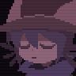<br/>
<sub><code>notes.entity</code></sub>

</td>
<td valign="top">

```
THE_WORLD_MACHINE > cat NOTES.txt
─────────────────────────────────────────────────────
  "Learning how to code is learning how to think."

  Clean code is not about perfection.
  It is about clarity — writing for the person
  who reads it next. Even if that person is you.

  Every commit is a checkpoint.
  Every bug is a lesson.
  Every finished project is proof you can do it.

  The machine keeps running because you keep
  writing. That is all it takes.
─────────────────────────────────────────────────────
```

</td>
</tr>
</table>

<div align="center">

</div>

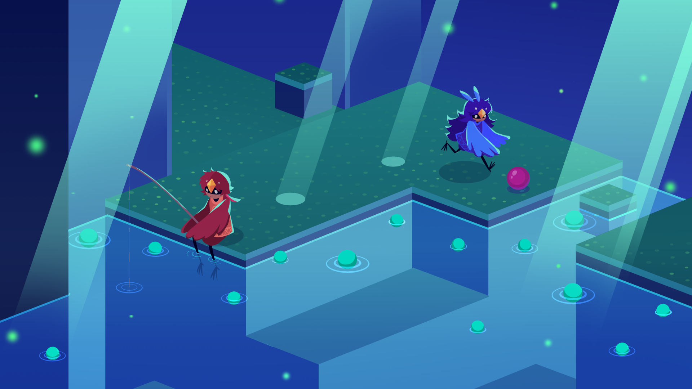

---

<!-- ════════════════════════════════════════════════
     POWER_STATUS — Energy
     ════════════════════════════════════════════════ -->

##  &nbsp;POWER_STATUS

<table>
<tr>
<td width="160" align="center" valign="top">

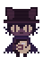<br/>
<br/>
<sub><code>power.sys</code></sub>

</td>
<td valign="top">

```
THE_WORLD_MACHINE > power --status
─────────────────────────────────────────────────────
  POWER LEVEL ... ████████████████████ 100%
  LIGHTBULB ..... GLOWING  ◆
  MACHINE ....... RUNNING
  MOTIVATION .... MAXIMUM
  SUN_STATUS .... ALIVE
─────────────────────────────────────────────────────
  > The sun needs an engineer.
  > The engineer needs a reason to code.
  > The reason is simple: BUILD THINGS.
─────────────────────────────────────────────────────
```

</td>
</tr>
</table>

<div align="center">

</div>

---

<!-- ════════════════════════════════════════════════
     CONTACTS — Establish Connection
     ════════════════════════════════════════════════ -->

##  &nbsp;CONTACTS

<table>
<tr>
<td width="160" align="center" valign="top">

<br/>
<sub><code>connect.sys</code></sub>

</td>
<td valign="top">

```
THE_WORLD_MACHINE > connect --channels
─────────────────────────────────────────────────────
  > Searching for available channels...
  > GitHub .............. OPEN
  > LinkedIn ............ [placeholder — update me]
  > Email ............... [placeholder — update me]
  > CONNECTION ESTABLISHED ■
─────────────────────────────────────────────────────
```

</td>
</tr>
</table>

<br/>

<div align="center">

<a href="https://github.com/PabloTrujilloArtunduaga">
  
</a>

<br/><br/>

<!-- Replace with real links when ready:
<a href="https://www.linkedin.com/in/YOUR-LINKEDIN/">
  
</a>
<a href="mailto:YOUR@EMAIL.com">
  
</a>
-->

</div>

---

<!-- ════════════════════════════════════════════════
     FOOTER — The World Machine
     ════════════════════════════════════════════════ -->

<div align="center">

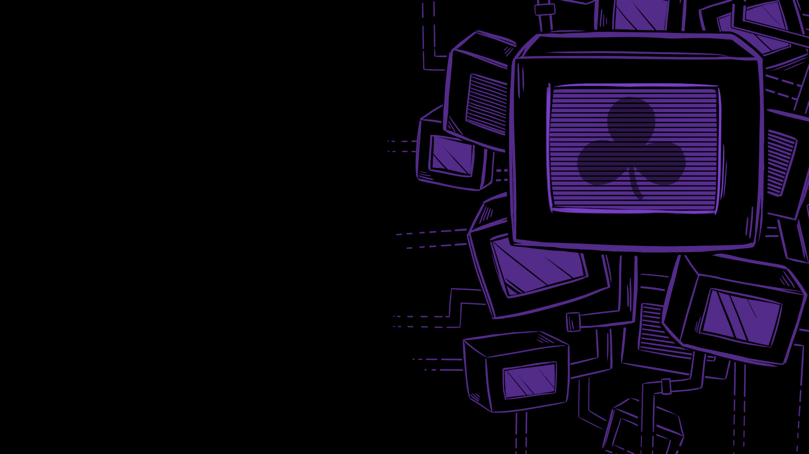

<br/>

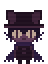
&nbsp;&nbsp;&nbsp;
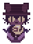
&nbsp;&nbsp;&nbsp;


<br/>


<br/>

```
THE_WORLD_MACHINE > session --close
─────────────────────────────────────────────────────
  > Explore my repositories.
  > Follow the journey.
  > END OF TRANSMISSION.
  > THE LIGHT STAYS ON. ▮
─────────────────────────────────────────────────────
```

<sub>
Sprites and faces used under fair-use fan work principles · Wallpapers from
<a href="https://github.com/pdn6606/TWM-xfce">pdn6606/TWM-xfce</a> (MIT license) ·
OneShot: World Machine Edition is a game by <strong>Future Cat LLC / Nightmargin</strong> ·
All rights reserved to their respective owners.
</sub>

</div>
